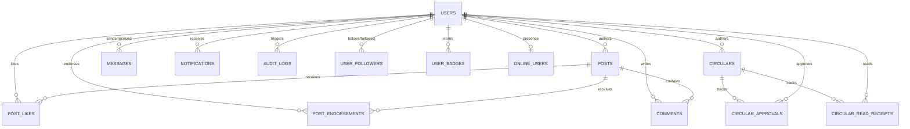

# SCHEMA MAPPING SPECIFICATION: MongoDB to MySQL 8 Relational
**Architect**: Principal Architect & Staff Database Specialist  
**System**: CircuLink Campus Intelligence Platform  
**Source Engine**: MongoDB 6+ / Mongoose 7.3.1 (Document-Store)  
**Target Engine**: MySQL 8.0+ (InnoDB Engine) / Spring Data JPA  
**Status**: APPROVED FOR IMPLEMENTATION

---

## 1. Architectural Normalization Overview

MongoDB stored relationships as embedded sub-documents (e.g. `User.badges`, `Post.likes`, `Post.endorsements`, `Circular.approvalChain`, `Circular.readBy`). In MySQL 8, all embedded array patterns are fully normalized into Third Normal Form (3NF) relational tables with foreign keys and `ON DELETE CASCADE` constraints, ensuring referential integrity and eliminating document bloat.

### Entity Relationship Diagram (Conceptual Relational Architecture)



---

## 2. Table-by-Table Schema Specification

### 2.1 Table: `users`
Replaces Mongoose `User` collection.
```sql
CREATE TABLE users (
    id BIGINT AUTO_INCREMENT PRIMARY KEY,
    college_id VARCHAR(50) UNIQUE NULL,
    email VARCHAR(191) NOT NULL UNIQUE,
    password VARCHAR(255) NOT NULL,
    name VARCHAR(150) NOT NULL,
    role ENUM('STUDENT', 'FACULTY', 'HOD', 'DSW', 'DEAN', 'DIRECTOR', 'SECURITY', 'ADMIN') NOT NULL,
    branch ENUM('CSE', 'ECE', 'EEE', 'MECH', 'CIVIL', 'CHEM', 'MMT', 'MME', 'GENERAL', 'PUC') NULL,
    campus ENUM('RK Valley', 'Nuzvid', 'Basar', 'Srikakulam', 'Ongole') NOT NULL,
    year ENUM('PUC-1', 'PUC-2', 'E1', 'E2', 'E3', 'E4') NULL,
    section VARCHAR(20) NULL,
    profile_picture VARCHAR(500) DEFAULT '',
    bio VARCHAR(300) DEFAULT '',
    phone VARCHAR(20) DEFAULT '',
    points INT NOT NULL DEFAULT 0,
    streak_days INT NOT NULL DEFAULT 0,
    level ENUM('Beginner', 'Intermediate', 'Advanced', 'Expert') NOT NULL DEFAULT 'Beginner',
    mfa_enabled BOOLEAN NOT NULL DEFAULT FALSE,
    mfa_secret VARCHAR(255) NULL,
    is_active BOOLEAN NOT NULL DEFAULT TRUE,
    is_verified BOOLEAN NOT NULL DEFAULT FALSE,
    last_login DATETIME(3) NULL,
    last_active_date DATE NULL,
    refresh_token_hash VARCHAR(64) NULL,
    password_reset_token VARCHAR(128) NULL,
    password_reset_expires DATETIME(3) NULL,
    theme ENUM('light', 'dark') NOT NULL DEFAULT 'light',
    language ENUM('en', 'te') NOT NULL DEFAULT 'en',
    google_id VARCHAR(100) UNIQUE NULL,
    is_google_user BOOLEAN NOT NULL DEFAULT FALSE,
    joined_community BOOLEAN NOT NULL DEFAULT FALSE,
    community_joined_at DATETIME(3) NULL,
    created_at DATETIME(3) NOT NULL DEFAULT CURRENT_TIMESTAMP(3),
    updated_at DATETIME(3) NOT NULL DEFAULT CURRENT_TIMESTAMP(3) ON UPDATE CURRENT_TIMESTAMP(3),
    INDEX idx_users_campus_role (campus, role),
    INDEX idx_users_email (email),
    INDEX idx_users_college_id (college_id),
    INDEX idx_users_points (points DESC)
) ENGINE=InnoDB DEFAULT CHARSET=utf8mb4 COLLATE=utf8mb4_unicode_ci;
```

---

### 2.2 Table: `user_badges`
Normalizes Mongoose `User.badges` array.
```sql
CREATE TABLE user_badges (
    id BIGINT AUTO_INCREMENT PRIMARY KEY,
    user_id BIGINT NOT NULL,
    badge_name VARCHAR(100) NOT NULL,
    awarded_at DATETIME(3) NOT NULL DEFAULT CURRENT_TIMESTAMP(3),
    CONSTRAINT fk_user_badges_user FOREIGN KEY (user_id) REFERENCES users(id) ON DELETE CASCADE,
    UNIQUE KEY uk_user_badge (user_id, badge_name)
) ENGINE=InnoDB DEFAULT CHARSET=utf8mb4 COLLATE=utf8mb4_unicode_ci;
```

---

### 2.3 Table: `user_followers`
Normalizes Mongoose `User.following` and `User.followers` arrays.
```sql
CREATE TABLE user_followers (
    follower_id BIGINT NOT NULL,
    following_id BIGINT NOT NULL,
    created_at DATETIME(3) NOT NULL DEFAULT CURRENT_TIMESTAMP(3),
    PRIMARY KEY (follower_id, following_id),
    CONSTRAINT fk_uf_follower FOREIGN KEY (follower_id) REFERENCES users(id) ON DELETE CASCADE,
    CONSTRAINT fk_uf_following FOREIGN KEY (following_id) REFERENCES users(id) ON DELETE CASCADE
) ENGINE=InnoDB DEFAULT CHARSET=utf8mb4 COLLATE=utf8mb4_unicode_ci;
```

---

### 2.4 Table: `posts`
Replaces Mongoose `Post` collection.
```sql
CREATE TABLE posts (
    id BIGINT AUTO_INCREMENT PRIMARY KEY,
    author_id BIGINT NOT NULL,
    title VARCHAR(200) NOT NULL,
    content TEXT NOT NULL,
    type ENUM('INNOVATION', 'RESEARCH', 'PROJECT', 'IDEA', 'SOCIAL_SERVICE', 'ACHIEVEMENT', 'GENERAL') NOT NULL DEFAULT 'GENERAL',
    branch ENUM('CSE', 'ECE', 'EEE', 'MECH', 'CIVIL', 'CHEM', 'MMT', 'ALL') NOT NULL DEFAULT 'ALL',
    campus ENUM('RK Valley', 'Nuzvid', 'Basar', 'Srikakulam', 'Ongole', 'ALL') NOT NULL DEFAULT 'ALL',
    visibility ENUM('PUBLIC', 'BRANCH', 'CAMPUS', 'DEPARTMENT') NOT NULL DEFAULT 'PUBLIC',
    thumbnail_url VARCHAR(500) NULL,
    likes_count INT NOT NULL DEFAULT 0,
    endorsements_count INT NOT NULL DEFAULT 0,
    shares INT NOT NULL DEFAULT 0,
    views INT NOT NULL DEFAULT 0,
    status ENUM('DRAFT', 'PUBLISHED', 'ARCHIVED', 'FLAGGED') NOT NULL DEFAULT 'PUBLISHED',
    is_featured BOOLEAN NOT NULL DEFAULT FALSE,
    is_pinned BOOLEAN NOT NULL DEFAULT FALSE,
    version INT NOT NULL DEFAULT 1,
    created_at DATETIME(3) NOT NULL DEFAULT CURRENT_TIMESTAMP(3),
    updated_at DATETIME(3) NOT NULL DEFAULT CURRENT_TIMESTAMP(3) ON UPDATE CURRENT_TIMESTAMP(3),
    CONSTRAINT fk_posts_author FOREIGN KEY (author_id) REFERENCES users(id) ON DELETE CASCADE,
    INDEX idx_posts_author_created (author_id, created_at DESC),
    INDEX idx_posts_status_branch_campus (status, branch, campus),
    FULLTEXT INDEX ft_posts_search (title, content)
) ENGINE=InnoDB DEFAULT CHARSET=utf8mb4 COLLATE=utf8mb4_unicode_ci;
```

---

### 2.5 Table: `post_topics` & `post_tags`
Normalizes Mongoose `Post.topics` and `Post.tags`.
```sql
CREATE TABLE post_topics (
    post_id BIGINT NOT NULL,
    topic VARCHAR(50) NOT NULL,
    PRIMARY KEY (post_id, topic),
    CONSTRAINT fk_post_topics_post FOREIGN KEY (post_id) REFERENCES posts(id) ON DELETE CASCADE,
    INDEX idx_topic (topic)
) ENGINE=InnoDB DEFAULT CHARSET=utf8mb4 COLLATE=utf8mb4_unicode_ci;

CREATE TABLE post_tags (
    post_id BIGINT NOT NULL,
    tag VARCHAR(50) NOT NULL,
    PRIMARY KEY (post_id, tag),
    CONSTRAINT fk_post_tags_post FOREIGN KEY (post_id) REFERENCES posts(id) ON DELETE CASCADE
) ENGINE=InnoDB DEFAULT CHARSET=utf8mb4 COLLATE=utf8mb4_unicode_ci;
```

---

### 2.6 Table: `post_likes` & `post_endorsements`
Normalizes Mongoose `Post.likes` and `Post.endorsements`.
```sql
CREATE TABLE post_likes (
    post_id BIGINT NOT NULL,
    user_id BIGINT NOT NULL,
    created_at DATETIME(3) NOT NULL DEFAULT CURRENT_TIMESTAMP(3),
    PRIMARY KEY (post_id, user_id),
    CONSTRAINT fk_pl_post FOREIGN KEY (post_id) REFERENCES posts(id) ON DELETE CASCADE,
    CONSTRAINT fk_pl_user FOREIGN KEY (user_id) REFERENCES users(id) ON DELETE CASCADE
) ENGINE=InnoDB DEFAULT CHARSET=utf8mb4 COLLATE=utf8mb4_unicode_ci;

CREATE TABLE post_endorsements (
    id BIGINT AUTO_INCREMENT PRIMARY KEY,
    post_id BIGINT NOT NULL,
    faculty_id BIGINT NOT NULL,
    message VARCHAR(500) NULL,
    weight INT NOT NULL DEFAULT 1,
    created_at DATETIME(3) NOT NULL DEFAULT CURRENT_TIMESTAMP(3),
    CONSTRAINT fk_pe_post FOREIGN KEY (post_id) REFERENCES posts(id) ON DELETE CASCADE,
    CONSTRAINT fk_pe_faculty FOREIGN KEY (faculty_id) REFERENCES users(id) ON DELETE CASCADE,
    UNIQUE KEY uk_post_faculty_endorsement (post_id, faculty_id)
) ENGINE=InnoDB DEFAULT CHARSET=utf8mb4 COLLATE=utf8mb4_unicode_ci;
```

---

### 2.7 Table: `comments`
Replaces Mongoose `Comment` collection.
```sql
CREATE TABLE comments (
    id BIGINT AUTO_INCREMENT PRIMARY KEY,
    post_id BIGINT NOT NULL,
    author_id BIGINT NOT NULL,
    parent_comment_id BIGINT NULL,
    content VARCHAR(1000) NOT NULL,
    is_edited BOOLEAN NOT NULL DEFAULT FALSE,
    edited_at DATETIME(3) NULL,
    created_at DATETIME(3) NOT NULL DEFAULT CURRENT_TIMESTAMP(3),
    updated_at DATETIME(3) NOT NULL DEFAULT CURRENT_TIMESTAMP(3) ON UPDATE CURRENT_TIMESTAMP(3),
    CONSTRAINT fk_comments_post FOREIGN KEY (post_id) REFERENCES posts(id) ON DELETE CASCADE,
    CONSTRAINT fk_comments_author FOREIGN KEY (author_id) REFERENCES users(id) ON DELETE CASCADE,
    CONSTRAINT fk_comments_parent FOREIGN KEY (parent_comment_id) REFERENCES comments(id) ON DELETE CASCADE,
    INDEX idx_comments_post_created (post_id, created_at ASC)
) ENGINE=InnoDB DEFAULT CHARSET=utf8mb4 COLLATE=utf8mb4_unicode_ci;
```

---

### 2.8 Table: `circulars`
Replaces Mongoose `Circular` collection.
```sql
CREATE TABLE circulars (
    id BIGINT AUTO_INCREMENT PRIMARY KEY,
    circular_number VARCHAR(100) UNIQUE NOT NULL,
    author_id BIGINT NOT NULL,
    author_role VARCHAR(50) NOT NULL,
    title VARCHAR(300) NOT NULL,
    content MEDIUMTEXT NOT NULL,
    category ENUM('ACADEMIC', 'ADMINISTRATIVE', 'EXAM', 'EVENT', 'HOLIDAY', 'EMERGENCY', 'PLACEMENT', 'SPORTS', 'CULTURAL', 'OTHER') NOT NULL,
    priority ENUM('LOW', 'MEDIUM', 'HIGH', 'URGENT') NOT NULL DEFAULT 'MEDIUM',
    status ENUM('DRAFT', 'PENDING_HOD', 'PENDING_DEAN', 'PENDING_DIRECTOR', 'APPROVED', 'REJECTED', 'PUBLISHED') NOT NULL DEFAULT 'DRAFT',
    requires_acknowledgment BOOLEAN NOT NULL DEFAULT FALSE,
    publish_date DATETIME(3) NULL,
    expiry_date DATETIME(3) NULL,
    is_active BOOLEAN NOT NULL DEFAULT TRUE,
    rejected_by_id BIGINT NULL,
    rejection_reason VARCHAR(500) NULL,
    version INT NOT NULL DEFAULT 1,
    created_at DATETIME(3) NOT NULL DEFAULT CURRENT_TIMESTAMP(3),
    updated_at DATETIME(3) NOT NULL DEFAULT CURRENT_TIMESTAMP(3) ON UPDATE CURRENT_TIMESTAMP(3),
    CONSTRAINT fk_circulars_author FOREIGN KEY (author_id) REFERENCES users(id) ON DELETE CASCADE,
    CONSTRAINT fk_circulars_rejector FOREIGN KEY (rejected_by_id) REFERENCES users(id) ON DELETE SET NULL,
    INDEX idx_circulars_status_created (status, created_at DESC),
    INDEX idx_circulars_priority (priority),
    FULLTEXT INDEX ft_circulars_search (title, content)
) ENGINE=InnoDB DEFAULT CHARSET=utf8mb4 COLLATE=utf8mb4_unicode_ci;
```

---

### 2.9 Table: `circular_targets`
Normalizes Mongoose `targetBranches`, `targetCampuses`, `targetYears`.
```sql
CREATE TABLE circular_targets (
    id BIGINT AUTO_INCREMENT PRIMARY KEY,
    circular_id BIGINT NOT NULL,
    target_type ENUM('BRANCH', 'CAMPUS', 'YEAR') NOT NULL,
    target_value VARCHAR(50) NOT NULL,
    CONSTRAINT fk_ct_circular FOREIGN KEY (circular_id) REFERENCES circulars(id) ON DELETE CASCADE,
    INDEX idx_circular_target (target_type, target_value)
) ENGINE=InnoDB DEFAULT CHARSET=utf8mb4 COLLATE=utf8mb4_unicode_ci;
```

---

### 2.10 Table: `circular_approvals`
Normalizes Mongoose `Circular.approvalChain` array.
```sql
CREATE TABLE circular_approvals (
    id BIGINT AUTO_INCREMENT PRIMARY KEY,
    circular_id BIGINT NOT NULL,
    step_order INT NOT NULL, -- 0: HOD, 1: DEAN/DSW, 2: DIRECTOR
    role ENUM('HOD', 'DSW', 'DEAN', 'DIRECTOR') NOT NULL,
    status ENUM('PENDING', 'APPROVED', 'REJECTED') NOT NULL DEFAULT 'PENDING',
    approved_by_id BIGINT NULL,
    comment VARCHAR(500) DEFAULT '',
    action_at DATETIME(3) NULL,
    CONSTRAINT fk_ca_circular FOREIGN KEY (circular_id) REFERENCES circulars(id) ON DELETE CASCADE,
    CONSTRAINT fk_ca_approver FOREIGN KEY (approved_by_id) REFERENCES users(id) ON DELETE SET NULL,
    UNIQUE KEY uk_circular_step (circular_id, step_order)
) ENGINE=InnoDB DEFAULT CHARSET=utf8mb4 COLLATE=utf8mb4_unicode_ci;
```

---

### 2.11 Table: `circular_read_receipts` & `circular_acknowledgments`
Normalizes Mongoose `Circular.readBy` and `Circular.acknowledgedBy` arrays.
```sql
CREATE TABLE circular_read_receipts (
    circular_id BIGINT NOT NULL,
    user_id BIGINT NOT NULL,
    read_at DATETIME(3) NOT NULL DEFAULT CURRENT_TIMESTAMP(3),
    PRIMARY KEY (circular_id, user_id),
    CONSTRAINT fk_crr_circular FOREIGN KEY (circular_id) REFERENCES circulars(id) ON DELETE CASCADE,
    CONSTRAINT fk_crr_user FOREIGN KEY (user_id) REFERENCES users(id) ON DELETE CASCADE
) ENGINE=InnoDB DEFAULT CHARSET=utf8mb4 COLLATE=utf8mb4_unicode_ci;

CREATE TABLE circular_acknowledgments (
    circular_id BIGINT NOT NULL,
    user_id BIGINT NOT NULL,
    acknowledged_at DATETIME(3) NOT NULL DEFAULT CURRENT_TIMESTAMP(3),
    PRIMARY KEY (circular_id, user_id),
    CONSTRAINT fk_ca_ack_circular FOREIGN KEY (circular_id) REFERENCES circulars(id) ON DELETE CASCADE,
    CONSTRAINT fk_ca_ack_user FOREIGN KEY (user_id) REFERENCES users(id) ON DELETE CASCADE
) ENGINE=InnoDB DEFAULT CHARSET=utf8mb4 COLLATE=utf8mb4_unicode_ci;
```

---

### 2.12 Table: `messages`
Replaces Mongoose `Message` collection.
```sql
CREATE TABLE messages (
    id BIGINT AUTO_INCREMENT PRIMARY KEY,
    sender_id BIGINT NOT NULL,
    receiver_id BIGINT NOT NULL,
    content TEXT NULL, -- Stored as AES-256 ciphertext from frontend
    file_url VARCHAR(500) NULL,
    file_type ENUM('image', 'file') NULL,
    file_name VARCHAR(255) NULL,
    is_read BOOLEAN NOT NULL DEFAULT FALSE,
    read_at DATETIME(3) NULL,
    created_at DATETIME(3) NOT NULL DEFAULT CURRENT_TIMESTAMP(3),
    CONSTRAINT fk_messages_sender FOREIGN KEY (sender_id) REFERENCES users(id) ON DELETE CASCADE,
    CONSTRAINT fk_messages_receiver FOREIGN KEY (receiver_id) REFERENCES users(id) ON DELETE CASCADE,
    INDEX idx_messages_conversation (sender_id, receiver_id, created_at DESC),
    INDEX idx_messages_unread (receiver_id, is_read)
) ENGINE=InnoDB DEFAULT CHARSET=utf8mb4 COLLATE=utf8mb4_unicode_ci;
```

---

### 2.13 Table: `online_users`
Replaces in-memory Node `Map` with persistence table.
```sql
CREATE TABLE online_users (
    user_id BIGINT PRIMARY KEY,
    session_id VARCHAR(100) NOT NULL,
    last_heartbeat DATETIME(3) NOT NULL DEFAULT CURRENT_TIMESTAMP(3) ON UPDATE CURRENT_TIMESTAMP(3),
    CONSTRAINT fk_online_users_user FOREIGN KEY (user_id) REFERENCES users(id) ON DELETE CASCADE,
    INDEX idx_online_heartbeat (last_heartbeat)
) ENGINE=InnoDB DEFAULT CHARSET=utf8mb4 COLLATE=utf8mb4_unicode_ci;
```

---

### 2.14 Table: `notifications` & `audit_logs`
```sql
CREATE TABLE notifications (
    id BIGINT AUTO_INCREMENT PRIMARY KEY,
    recipient_id BIGINT NOT NULL,
    sender_id BIGINT NULL,
    type VARCHAR(50) NOT NULL,
    title VARCHAR(200) NOT NULL,
    message TEXT NOT NULL,
    link VARCHAR(500) NULL,
    related_post_id BIGINT NULL,
    related_circular_id BIGINT NULL,
    is_read BOOLEAN NOT NULL DEFAULT FALSE,
    read_at DATETIME(3) NULL,
    priority ENUM('LOW', 'MEDIUM', 'HIGH', 'URGENT') NOT NULL DEFAULT 'MEDIUM',
    is_emergency BOOLEAN NOT NULL DEFAULT FALSE,
    created_at DATETIME(3) NOT NULL DEFAULT CURRENT_TIMESTAMP(3),
    CONSTRAINT fk_notifications_recipient FOREIGN KEY (recipient_id) REFERENCES users(id) ON DELETE CASCADE,
    CONSTRAINT fk_notifications_sender FOREIGN KEY (sender_id) REFERENCES users(id) ON DELETE SET NULL,
    CONSTRAINT fk_notifications_post FOREIGN KEY (related_post_id) REFERENCES posts(id) ON DELETE SET NULL,
    CONSTRAINT fk_notifications_circular FOREIGN KEY (related_circular_id) REFERENCES circulars(id) ON DELETE SET NULL,
    INDEX idx_notifications_recipient_unread (recipient_id, is_read, created_at DESC)
) ENGINE=InnoDB DEFAULT CHARSET=utf8mb4 COLLATE=utf8mb4_unicode_ci;

CREATE TABLE audit_logs (
    id BIGINT AUTO_INCREMENT PRIMARY KEY,
    user_id BIGINT NOT NULL,
    action VARCHAR(50) NOT NULL,
    resource_type VARCHAR(50) NULL,
    resource_id BIGINT NULL,
    details JSON NULL,
    ip_address VARCHAR(45) NULL,
    user_agent VARCHAR(255) NULL,
    campus VARCHAR(50) NULL,
    branch VARCHAR(50) NULL,
    created_at DATETIME(3) NOT NULL DEFAULT CURRENT_TIMESTAMP(3),
    CONSTRAINT fk_audit_user FOREIGN KEY (user_id) REFERENCES users(id) ON DELETE CASCADE,
    INDEX idx_audit_user_action (user_id, action, created_at DESC)
) ENGINE=InnoDB DEFAULT CHARSET=utf8mb4 COLLATE=utf8mb4_unicode_ci;
```

---

## 3. Data Migration & Seed Strategy

A high-performance Spring Boot `CommandLineRunner` (`DataMigrationSeedRunner.java`) and a standalone SQL script (`database/seed.sql`) will populate initial administrative, staff, and student personas across all 4 RGUKT campuses with pre-hashed BCrypt passwords, ensuring seamless development and testing out of the box.
