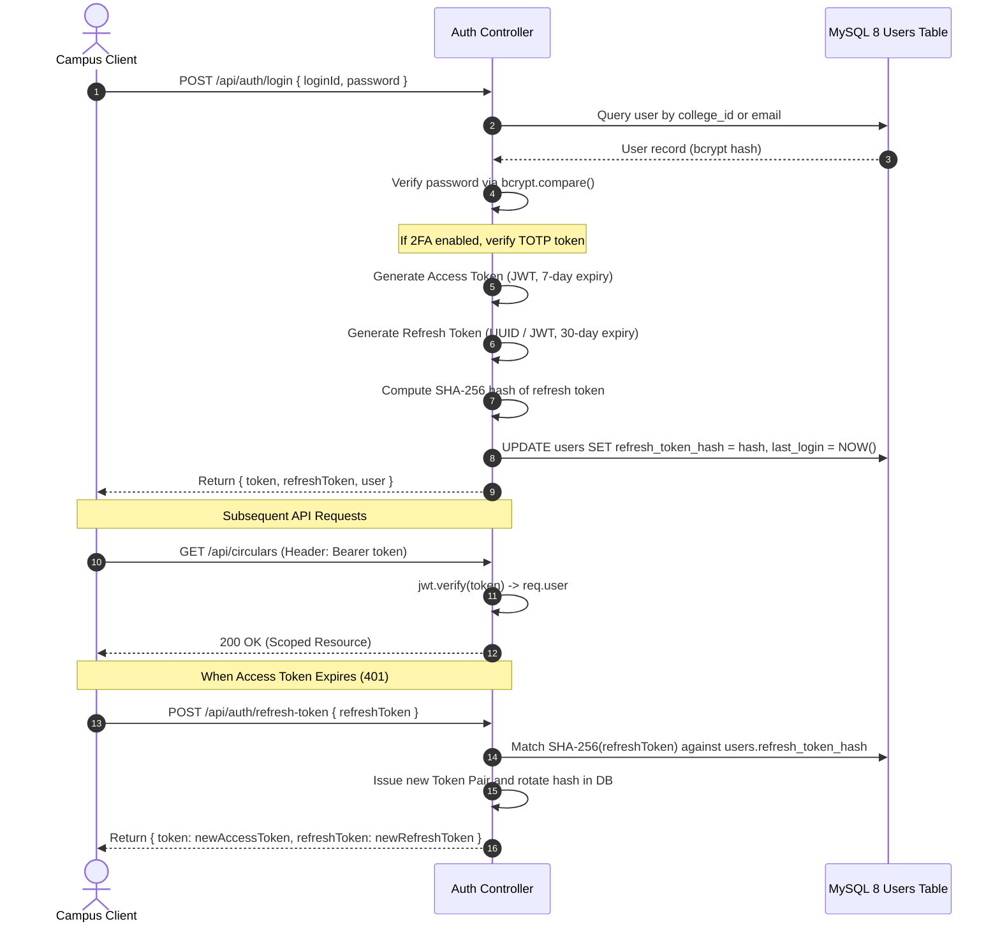

# Authentication & Authorization Specification

**Platform**: CircuLink Campus Intelligence Platform  
**Security Standard**: Least-Privilege Role-Based Access Control (RBAC) & OAuth 2.0 PKCE  

---

## 1. Authentication Architecture & Token Lifecycle

CircuLink implements a secure dual-token authentication model using JSON Web Tokens (JWT) and persistent refresh token rotation:

---

## 2. Institutional Role-Based Access Control (RBAC) Matrix

CircuLink enforces an 8-tier hierarchical role permission model:

| Capability / Action | STUDENT | FACULTY | HOD | DSW | DEAN | DIRECTOR | SECURITY | ADMIN |
|---|:---:|:---:|:---:|:---:|:---:|:---:|:---:|:---:|
| **Read Published Circulars** | ✅ | ✅ | ✅ | ✅ | ✅ | ✅ | ✅ | ✅ |
| **Acknowledge Urgent Notices** | ✅ | ✅ | ✅ | ✅ | ✅ | ✅ | ✅ | ✅ |
| **Publish Innovation Post** | ✅ | ✅ | ✅ | ✅ | ✅ | ✅ | — | ✅ |
| **Grant Faculty Endorsement (+15 pts)** | — | ✅ | ✅ | ✅ | ✅ | ✅ | — | ✅ |
| **Draft Institutional Circular** | — | ✅ | ✅ | ✅ | ✅ | ✅ | — | ✅ |
| **HOD Stage 1 Circular Approval** | — | — | ✅ | — | — | ✅ | — | ✅ |
| **Dean Stage 2 Circular Approval** | — | — | — | ✅ | ✅ | ✅ | — | ✅ |
| **Director Final Publication** | — | — | — | — | — | ✅ | — | ✅ |
| **Trigger Campus Emergency Broadcast** | — | — | — | — | — | ✅ | ✅ | ✅ |
| **Access Campus Analytics Dashboard** | — | — | — | ✅ | ✅ | ✅ | — | ✅ |
| **Manage Multi-Campus Configurations** | — | — | — | — | — | — | — | ✅ |

---

## 3. Cryptographic Storage & Password Policy

1. **Password Hashing**: Passwords are encrypted using `bcryptjs` with 12 salt rounds before persisting to MySQL. Plaintext passwords are never logged or stored.
2. **Two-Factor Authentication (MFA)**:
   - Built on RFC 6238 Time-Based One-Time Passwords (TOTP).
   - Generates 160-bit Base32 secret keys via `speakeasy`.
   - Verified across a ±1 time step tolerance window (30-second validity).
3. **End-to-End Chat Encryption**:
   - 1-to-1 direct messages use client-side AES-256 encryption (`CryptoJS.AES`).
   - Shared keys are derived deterministically using `SHA-256(min(id1, id2) + "_" + max(id1, id2) + salt)`.
