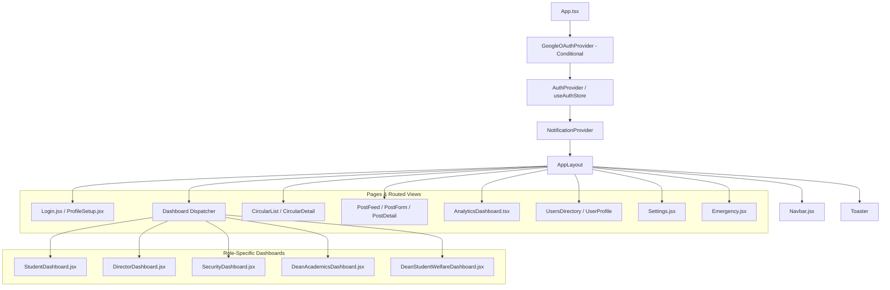
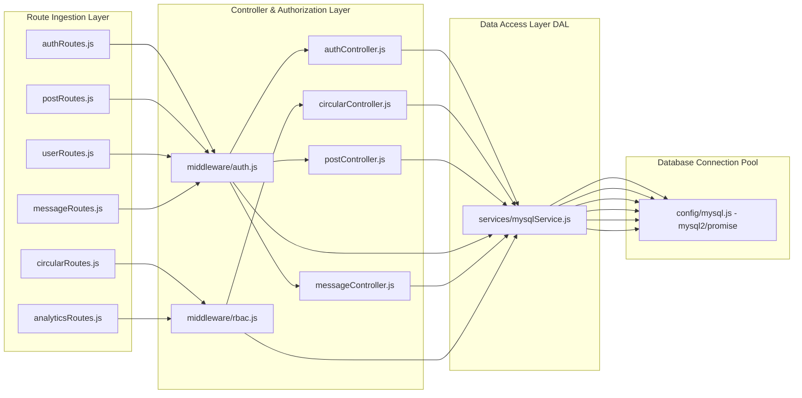

# Component Architecture: CircuLink Modular Design

**Author**: Senior Full-Stack Engineer  
**Scope**: Frontend Component Tree, State Architecture, Backend Service Decomposition  

---

## 1. Frontend Component Hierarchy

---

## 2. State Management Architecture

CircuLink implements a hybrid state management model:
1. **Server Cache State (TanStack Query v5)**:
   - Manages asynchronous remote data (feeds, circular lists, analytics overview).
   - Configured with a 5-minute stale-time cache, eliminating redundant network calls upon view switching.
2. **Atomic Client State (Zustand)**:
   - Stores authenticated user identity, dark mode theme preferences, and cached session tokens.
   - Prevents cascading re-renders across sibling components.
3. **Real-Time Context (`NotificationContext`)**:
   - Manages active Socket.IO connections, unread notification counts, and real-time pop-up toasts.

---

## 3. Backend Controller & Service Layer Decomposition

---

## 4. Component Communication & Lifecycle Rules

1. **Strict Decoupling**: Frontend components never issue raw SQL or direct database queries; all interactions flow through the Axios API client (`api/axios.ts`).
2. **Dynamic Media Resolution**: All media attachments, user avatars, and download links resolve through `getFileUrl()`, ensuring compatibility between local development, Vercel edge deployment, and cloud storage.
3. **Resilient OAuth**: Google OAuth hooks reside in leaf components (`GoogleLoginSection`) and only execute when `VITE_GOOGLE_CLIENT_ID` is present, safeguarding primary username/password authentication against runtime crashes.
