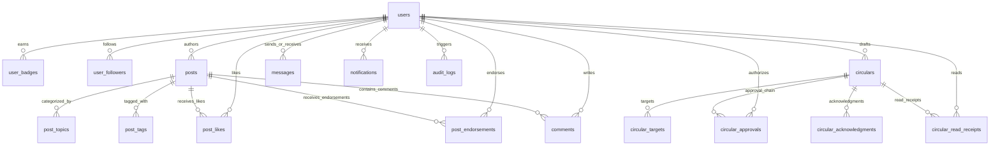

# Relational Database Schema: MySQL 8 3NF Reference

**Database Engine**: MySQL 8.0+ (InnoDB)  
**Character Set**: `utf8mb4` | **Collation**: `utf8mb4_unicode_ci`  
**Source DDL**: `database/schema.sql`  

---

## 1. Entity-Relationship Diagram (ERD)

---

## 2. Core Relational Entities

### 2.1 `users` Table
Stores student, faculty, and administrative identity records.

| Column | Type | Constraints | Description |
|---|---|---|---|
| `id` | BIGINT | PRIMARY KEY, AUTO_INCREMENT | Unique user identifier |
| `college_id` | VARCHAR(50) | UNIQUE, NULL | University College ID (e.g. `R200123`) |
| `email` | VARCHAR(191) | NOT NULL, UNIQUE | Institutional or personal email |
| `password` | VARCHAR(255) | NOT NULL | Bcrypt hashed security password |
| `name` | VARCHAR(150) | NOT NULL | Full legal or display name |
| `role` | ENUM | NOT NULL | `STUDENT`, `FACULTY`, `HOD`, `DSW`, `DEAN`, `DIRECTOR`, `SECURITY`, `ADMIN` |
| `campus` | ENUM | NOT NULL | `RK Valley`, `Nuzvid`, `Basar`, `Srikakulam`, `Ongole` |
| `branch` | ENUM | NULL | `CSE`, `ECE`, `EEE`, `MECH`, `CIVIL`, `CHEM`, `MMT`, `MME`, `GENERAL`, `PUC` |
| `year` | ENUM | NULL | `PUC-1`, `PUC-2`, `E1`, `E2`, `E3`, `E4` |
| `points` | INT | NOT NULL, DEFAULT 0 | Gamification reputation score |
| `level` | ENUM | NOT NULL, DEFAULT 'Beginner' | `Beginner`, `Intermediate`, `Advanced`, `Expert` |
| `streak_days` | INT | NOT NULL, DEFAULT 0 | Consecutive daily active logins |
| `mfa_enabled` | BOOLEAN | NOT NULL, DEFAULT FALSE | TOTP two-factor authentication flag |
| `mfa_secret` | VARCHAR(255) | NULL | Base32 encoded TOTP secret |
| `refresh_token_hash`| VARCHAR(64) | NULL | SHA-256 hash of active refresh token |

**Indexes**:
- `idx_users_campus_role (campus, role)`
- `idx_users_points (points DESC)`
- `idx_users_college_id (college_id)`

---

### 2.2 `circulars` Table
Central repository of official university notices and emergency announcements.

| Column | Type | Constraints | Description |
|---|---|---|---|
| `id` | BIGINT | PRIMARY KEY, AUTO_INCREMENT | Circular identifier |
| `circular_number` | VARCHAR(100) | UNIQUE, NOT NULL | Formatted circular code (e.g. `CIR/RKV/2026/042`) |
| `title` | VARCHAR(300) | NOT NULL | Official circular heading |
| `content` | LONGTEXT | NOT NULL | Formatted body text and notice directives |
| `category` | VARCHAR(100) | NOT NULL | `ACADEMIC`, `ADMINISTRATIVE`, `EXAMINATION`, `HOSTEL`, `SECURITY` |
| `priority` | ENUM | NOT NULL, DEFAULT 'NORMAL' | `LOW`, `NORMAL`, `HIGH`, `URGENT`, `EMERGENCY` |
| `status` | ENUM | NOT NULL, DEFAULT 'DRAFT' | `DRAFT`, `PENDING_HOD`, `PENDING_DEAN`, `PENDING_DIRECTOR`, `APPROVED`, `PUBLISHED`, `REJECTED` |
| `author_id` | BIGINT | NOT NULL, FK -> `users(id)` | User who drafted notice |
| `campus` | ENUM | NOT NULL | Issuing campus or `ALL` |
| `created_at` | DATETIME(3) | NOT NULL | Publication timestamp |

**Fulltext Search Index**:
- `FULLTEXT idx_circulars_search (title, content)`

---

### 2.3 `circular_approvals` Table
Immutable multi-tier sign-off log for administrative transparency.

| Column | Type | Constraints | Description |
|---|---|---|---|
| `id` | BIGINT | PRIMARY KEY, AUTO_INCREMENT | Approval step ID |
| `circular_id` | BIGINT | NOT NULL, FK -> `circulars(id)` ON DELETE CASCADE | Target circular |
| `approver_id` | BIGINT | NOT NULL, FK -> `users(id)` | Authorizing authority |
| `approver_role` | VARCHAR(50) | NOT NULL | Role at time of approval (`HOD`, `DEAN`, `DIRECTOR`) |
| `action` | ENUM | NOT NULL | `SUBMIT`, `ENDORSE`, `APPROVE`, `REJECT` |
| `comment` | TEXT | NULL | Administrative remarks or rejection reason |
| `created_at` | DATETIME(3) | NOT NULL | Timestamp of action |

---

### 2.4 `posts` Table (Innovation & Research Feed)
Student and faculty project showcases, research publications, and achievements.

| Column | Type | Constraints | Description |
|---|---|---|---|
| `id` | BIGINT | PRIMARY KEY, AUTO_INCREMENT | Post identifier |
| `author_id` | BIGINT | NOT NULL, FK -> `users(id)` | Project creator |
| `title` | VARCHAR(200) | NOT NULL | Project or research title |
| `content` | TEXT | NOT NULL | Description, methodology, deliverables |
| `type` | ENUM | NOT NULL | `INNOVATION`, `RESEARCH`, `PROJECT`, `IDEA`, `SOCIAL_SERVICE`, `ACHIEVEMENT`, `GENERAL` |
| `branch` | ENUM | NOT NULL, DEFAULT 'ALL' | Departmental scope |
| `campus` | ENUM | NOT NULL, DEFAULT 'ALL' | Campus scope |
| `likes_count` | INT | NOT NULL, DEFAULT 0 | Denormalized like counter for fast sorting |
| `endorsements_count`| INT | NOT NULL, DEFAULT 0 | Denormalized faculty endorsement counter |

**Indexes**:
- `FULLTEXT idx_posts_search (title, content)`
- `idx_posts_likes (likes_count DESC)`
- `idx_posts_campus_branch (campus, branch)`
