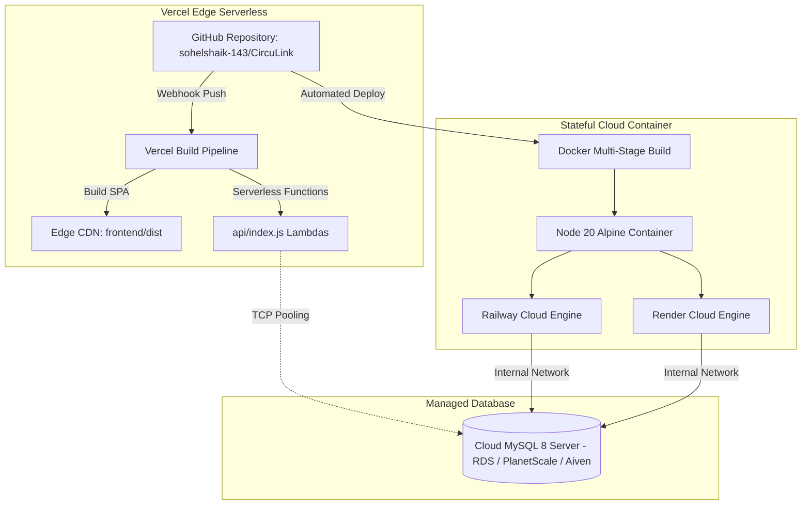

# Deployment Architecture & Cloud Infrastructure

**Platforms Supported**: Vercel Serverless, Docker Containerization, Railway PaaS, Render PaaS  
**Maintainer**: Principal DevSecOps Lead  

---

## 1. Cloud Infrastructure Overview



---

## 2. Vercel Serverless Deployment Architecture

### 2.1 Manifest Configuration (`vercel.json`)
```json
{
  "version": 2,
  "buildCommand": "cd frontend && npm install && npm run build",
  "outputDirectory": "frontend/dist",
  "rewrites": [
    { "source": "/api/(.*)", "destination": "/api/index.js" },
    { "source": "/api", "destination": "/api/index.js" },
    { "source": "/uploads/(.*)", "destination": "/api/index.js" },
    { "source": "/(.*)", "destination": "/index.html" }
  ]
}
```

### 2.2 Serverless Function Entry Point (`api/index.js`)
- Exports the Express application directly: `module.exports = app;`
- Vercel automatically wraps Express instances into Node.js serverless functions, executing route handlers in response to incoming HTTP calls.
- Static assets located in `frontend/dist` are deployed directly to Vercel's global Anycast Edge Network, achieving sub-50ms TTFB globally.

---

## 3. Docker Multi-Stage Containerization

### Dockerfile Breakdown
1. **Stage 1: Build Environment (`node:20-alpine`)**:
   - Copies frontend package files and executes `npm run build`.
   - Generates production-optimized JavaScript, CSS, and HTML chunks.
2. **Stage 2: Runtime Environment (`node:20-alpine`)**:
   - Installs production-only dependencies (`npm ci --only=production`).
   - Copies compiled frontend bundle into `frontend/dist`.
   - Exposes port `5000` and boots `server.js`.

### Running Locally with Docker
```bash
docker build -t circulink:2.0 .
docker run -p 5000:5000 --env-file .env circulink:2.0
```
