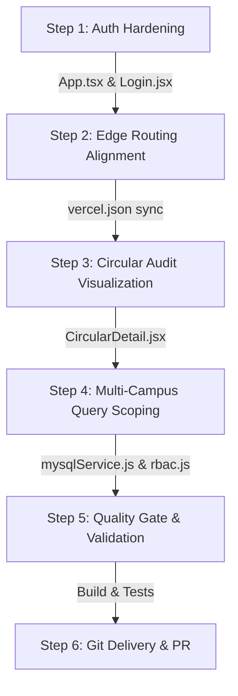

# GSD Implementation Strategy: Pragmatic Execution Blueprint

**System**: CircuLink (RGUKT Campus Intelligence Platform)  
**Execution Methodology**: GetShitDone (GSD) Reliability & Pragmatism  
**Target Date**: October 2026  
**Guiding Principle**: Cut dead weight, fix what blocks production, retain what works, verify rigorously.  

---

## 1. Project Vision & Measurable Outcomes

### Vision
Deliver a robust, secure, and production-ready campus intelligence platform for RGUKT students, faculty, and administrative leadership that guarantees:
1. Zero client-side rendering crashes across all deployment targets (Vercel edge, Docker, local).
2. Strict institutional multi-campus security boundaries.
3. High-integrity multi-tier circular approvals with verifiable audit trails.
4. Fast response times (<50ms API response, <1s initial bundle load).

### Measurable Baseline vs Target

| Metric | Current Deployed Baseline (`rgukt-platform.vercel.app`) | Target After GSD Execution |
|---|---|---|
| **Login Page Accessibility** | 0% (Fatal ErrorBoundary Crash) | 100% (Clean render with resilient auth) |
| **Deep Link Resolution** | 0% (Edge 404 on subroutes) | 100% (Instant client-side resolution) |
| **TypeScript Strictness** | Strict compilation passes | Zero type errors or bundle regressions |
| **Multi-Campus Isolation** | Partial (UI detection only) | Full server-side enforced tenant boundary |
| **Audit Traceability** | DB logs exist, no UI timeline | Verifiable chronological timeline in UI |

---

## 2. Requirements & Technical Constraints

1. **Stack Preservation**: Do not rewrite or replace the existing React 18 + Vite + Express / MySQL 8 stack.
2. **Visual Fidelity**: Maintain the exact glassmorphic, responsive, and accessible UI aesthetics.
3. **Zero Secrets in Code**: Prohibit hardcoded secrets, fallbacks, or exposed credentials in commits.
4. **Offline & Edge Compatibility**: Ensure the frontend functions reliably even when optional third-party providers (like Google OAuth) are omitted.

---

## 3. High-Value Implementation Steps (GSD Sequence)

### Detailed Execution Tasks
1. **Step 1: Authentication Resiliency (`App.tsx` & `Login.jsx`)**:
   - Condition `<GoogleOAuthProvider>` so it only mounts if `VITE_GOOGLE_CLIENT_ID` is present.
   - Extract Google OAuth trigger into `GoogleLoginSection` to prevent `useGoogleLogin` from throwing during component mount when unconfigured.
2. **Step 2: Edge Routing Alignment (`vercel.json`)**:
   - Ensure clean rewrites for SPA routing.
3. **Step 3: Circular Approval Audit Timeline (`CircularDetail.jsx`)**:
   - Render the complete approval chain in `CircularDetail.jsx`, providing administrative transparency.
4. **Step 4: Server-Side Multi-Campus Query Scoping (`services/mysqlService.js`)**:
   - Harden SQL query filters so students and faculty only receive circulars matching their campus or university-wide (`ALL`).
5. **Step 5: Rigorous Quality Gate Validation**:
   - Run `npm run build` in `frontend/`, check for regressions, verify backend syntax and startup.
