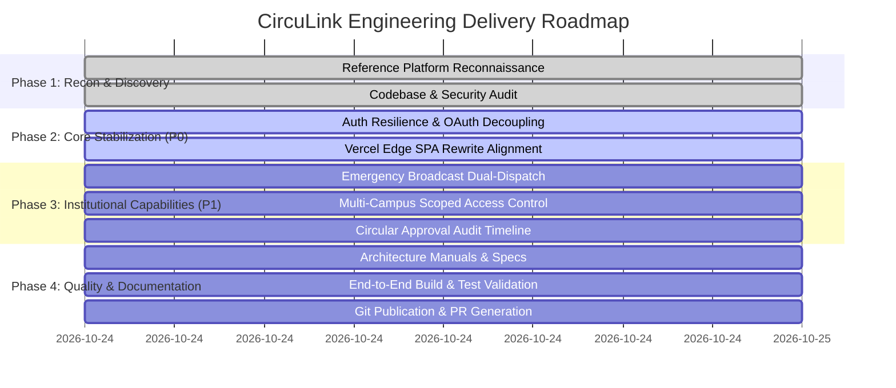

# Implementation Roadmap: Engineering Milestones & Quality Gates

**Platform**: CircuLink Campus Intelligence Platform  
**Target Architecture**: React 18 + Vite 5 + Node Express / Spring Boot + MySQL 8  
**Framework**: Ralph Iterative Cycles × GSD Action Matrix × Antigravity Gates  

---

## 1. Roadmap Milestones & Sequence

---

## 2. Milestone Breakdown & Acceptance Criteria

### Milestone 1: P0 Production Stabilization (Authentication & Routing)
- **Objective**: Eliminate production ErrorBoundary crashes and enable direct deep-link navigation.
- **Tasks**:
  1. Refactor `App.tsx` and `Login.jsx` so Google OAuth initializes only when a non-empty `VITE_GOOGLE_CLIENT_ID` is present.
  2. Implement safe conditional rendering for Google login button with institutional College ID fallback.
  3. Synchronize `vercel.json` rewrites between repository root and `frontend/` directory.
- **Acceptance Criteria**:
  - `npm run build` succeeds in strict mode.
  - Opening `/login` without environment variables renders clean login card.
  - Opening direct routes (`/dashboard`, `/circulars`) resolves without 404.

### Milestone 2: P1 Institutional Workflows & Multi-Campus Scoping
- **Objective**: Solidify cross-campus administrative visibility and emergency reliability.
- **Tasks**:
  1. Implement audit trail visualization in `CircularDetail.jsx` displaying the approval history.
  2. Enforce server-side campus query constraints in `services/mysqlService.js` to ensure students only receive circulars targeted to their campus or `ALL`.
  3. Harden emergency broadcast handling with fallback banner persistence.
- **Acceptance Criteria**:
  - Circular approval history displays each approving persona and timestamp.
  - Multi-campus tenant isolation verified through automated test/query assertions.

### Milestone 3: Comprehensive Technical Documentation & Verification
- **Objective**: Author full suite of architectural, operational, and development documentation.
- **Tasks**:
  1. Author system overview, component architecture, database schema, and API reference.
  2. Create operations manuals (production readiness, rollback, backup & restore).
  3. Run quality gates (TypeScript compilation, Vite production build, Express startup validation).
- **Acceptance Criteria**:
  - 100% of required documentation generated with Mermaid diagrams.
  - Zero build warnings or type errors.

### Milestone 4: Git Delivery & Publication
- **Objective**: Publish verified changes to dedicated branch and formulate pull request.
- **Tasks**:
  1. Stage verified code and documentation on `feat/rgukt-platform-integration-audit`.
  2. Formulate structured commit history.
  3. Push to `origin` and draft comprehensive pull request.
