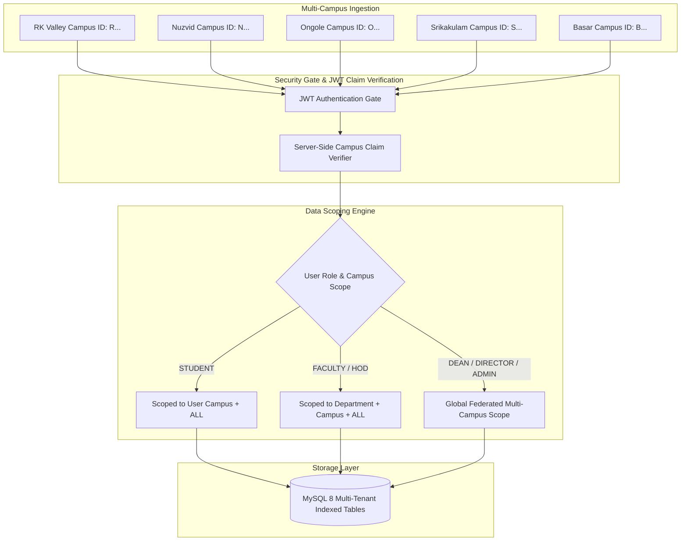

# Multi-Campus Security & Tenancy Architecture

**Platform**: CircuLink (RGUKT Unified Campus Intelligence Platform)  
**Author**: Principal Security Architect  
**Institution**: Rajiv Gandhi University of Knowledge Technologies (RGUKT)  
**Campuses Governed**: RK Valley, Nuzvid, Srikakulam, Ongole, Basar  

---

## 1. Multi-Campus Threat Model & Tenancy Boundaries

---

## 2. Campus Identifiers & Data Ownership

| Campus Code | Campus Name | Established | State | Primary Webmail Domain | College ID Prefix |
|---|---|---|---|---|---|
| **R** | RK Valley (Idupulapaya) | 2008 | Andhra Pradesh | `@rguktrkv.ac.in` | `R` (e.g. `R200123`) |
| **N** | Nuzvid | 2008 | Andhra Pradesh | `@rguktnuz.ac.in` | `N` (e.g. `N190456`) |
| **O** | Ongole | 2016 | Andhra Pradesh | `@rguktong.ac.in` | `O` (e.g. `O210789`) |
| **S** | Srikakulam | 2016 | Andhra Pradesh | `@rguktskl.ac.in` | `S` (e.g. `S220345`) |
| **B** | Basar | 2008 | Telangana | `@rgukt.ac.in` | `B` (e.g. `B180012`) |

### Tenancy Isolation Rules
1. **Never Trust Browser-Supplied Campus**: The user's authenticated campus is derived exclusively from the signed JWT payload (`req.user.campus`), backed by the immutable database record in `users`.
2. **Circular Target Enclosure**: Circulars with `targetCampuses = ['RK Valley']` can never be queried or viewed by students bound to `Nuzvid` or `Ongole`.
3. **Cross-Campus Announcements**: Only institutional administrators (`DIRECTOR`, `DEAN`, `ADMIN`) can set `targetCampuses = ['ALL']`.
4. **Social & Innovation Collaboration**: Students across all campuses can view and collaborate on innovation projects (`posts`) flagged with `visibility = 'PUBLIC'`, encouraging university-wide technological exchange.

---

## 3. Institutional Adoption Disclaimer

> [!IMPORTANT]
> **Platform Adoption Status**: CircuLink is engineered as an advanced student- and faculty-developed campus intelligence platform. While architected to institutional production standards (ACID transactions, RBAC, encrypted communications), it operates as an independent innovation until formalized by the RGUKT Executive Committee and Vice-Chancellor's Secretariat. Live institutional integrations must adhere to formal university IT governance protocols.
