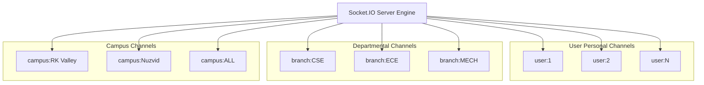

# Notifications & Event Architecture: Real-Time Event Dispatch

**Real-Time Engines**: Socket.IO 4.7+ (Node Server) & Spring STOMP Broker (Spring Module)  
**Scope**: Room Scoping, Event Taxonomy, Heartbeats, Serverless Fallbacks  

---

## 1. Real-Time Room & Channel Topology

---

## 2. Event Specification Matrix

| Event Name | Direction | Payload Schema | Target Channel | Description |
|---|:---:|---|---|---|
| `join` | Client -> Server | `userId: string` | Direct Socket | Registers socket connection and joins user-specific room. |
| `join_branch` | Client -> Server | `branch: string` | Direct Socket | Joins department room for branch-level notices. |
| `join_campus` | Client -> Server | `campus: string` | Direct Socket | Joins campus room for campus-scoped circulars. |
| `new_message` | Server -> Client | `{ message: MessageObject }` | `user:{receiverId}` | Dispatches real-time encrypted direct chat message. |
| `user_typing` | Server -> Client | `{ userName: string }` | Chat Room | Emits typing indicator to active chat partner. |
| `new_circular` | Server -> Client | `{ circular: CircularObject }`| `campus:{campus}` or Broadcast | Alerts online users of published official circulars. |
| `emergency_alert`| Server -> Client | `{ alert: AlertObject }` | Global Broadcast (`io.emit`) | Triggers emergency siren chime and modal across all sessions. |

---

## 3. Serverless Environment Compatibility (Vercel)

1. **Stateful vs Serverless Divergence**:
   - In containerized environments (Docker, Railway, Render), Socket.IO holds persistent TCP connections.
   - In serverless environments (Vercel Lambdas), continuous WebSocket connections terminate after lambda execution.
2. **Dual-Dispatch Resilience**:
   - Whenever an emergency or circular event is generated, it is concurrently committed to the MySQL `circulars` and `notifications` tables.
   - The frontend's `NotificationContext` implements a 30-second background polling cycle (`/api/notifications/unread`) that guarantees delivery even if WebSocket connection is unavailable.
