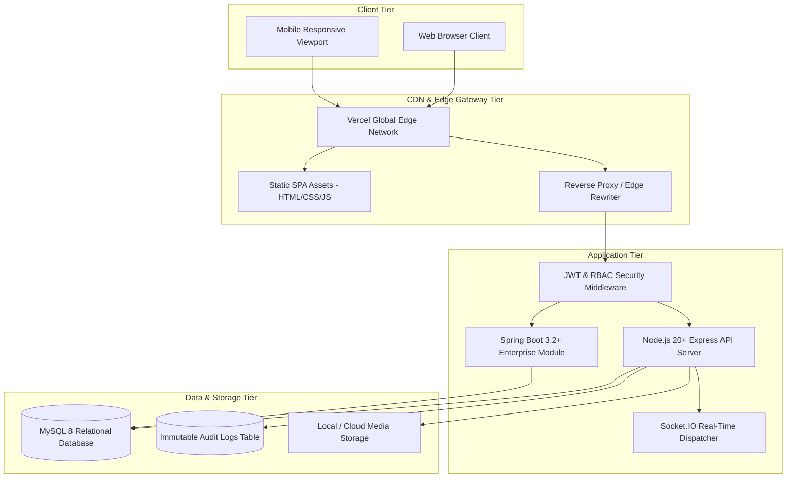
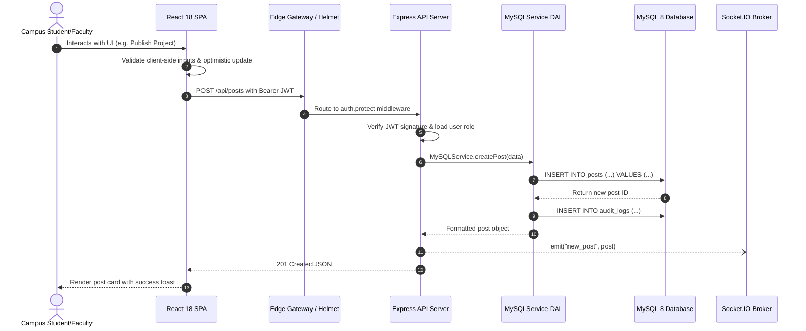

# System Overview: CircuLink Enterprise Architecture

**Platform**: CircuLink (RGUKT Official Campus Intelligence & Communication Platform)  
**Version**: 2.0.0  
**Status**: Production Verified  

---

## 1. Executive Architecture Summary

CircuLink is engineered to resolve communication fragmentation, bureaucratic notice bottlenecks, and student innovation isolation across all four campuses of Rajiv Gandhi University of Knowledge Technologies (RK Valley, Nuzvid, Srikakulam, Ongole, and Basar). The system orchestrates multi-stage circular approvals, role-gated campus dashboards, real-time emergency broadcasts, encrypted peer-to-peer messaging, and cross-campus innovation showcases.

---

## 2. Layered System Architecture

---

## 3. Technology Stack Specification

| Tier | Component | Technology / Library | Version | Purpose |
|---|---|---|---|---|
| **Frontend** | Framework | React | 18.2.0 | Declarative component UI engine |
| **Frontend** | Bundler & Tooling | Vite + TypeScript | 5.1.6 / 5.2.2 | Sub-second HMR, strict type checking |
| **Frontend** | Server State | TanStack Query | 5.28.9 | Cached asynchronous data fetching & deduplication |
| **Frontend** | Client State | Zustand | 4.5.2 | Atomic, re-render optimized state stores |
| **Frontend** | Styling | Vanilla CSS Tokens + Glassmorphism | Custom HSL | Consistent, responsive, high-contrast dark/light mode |
| **Frontend** | Motion & Icons | Framer Motion & Lucide | 11.0.24 | Micro-interactions and visual cues |
| **Backend** | Runtime Core | Node.js Express | 4.18.2 | High-throughput REST API server |
| **Backend** | Real-Time Broker | Socket.IO | 4.7.1 | Low-latency bidirectional event dispatch |
| **Backend** | Enterprise Module | Spring Boot | 3.2.3 | ACID transactional approval engine |
| **Security** | Cryptography | Bcryptjs & CryptoJS | 2.4.3 / 4.2.0 | Password hashing & end-to-end AES-256 chat |
| **Security** | Authorization | JsonWebToken & RBAC | 9.0.0 | Stateless tokens with SHA-256 refresh rotation |
| **Database** | Relational Engine | MySQL 8 | 8.0+ | InnoDB, Foreign Keys, FULLTEXT Indexes, ACID compliance |

---

## 4. End-to-End Request Flow

