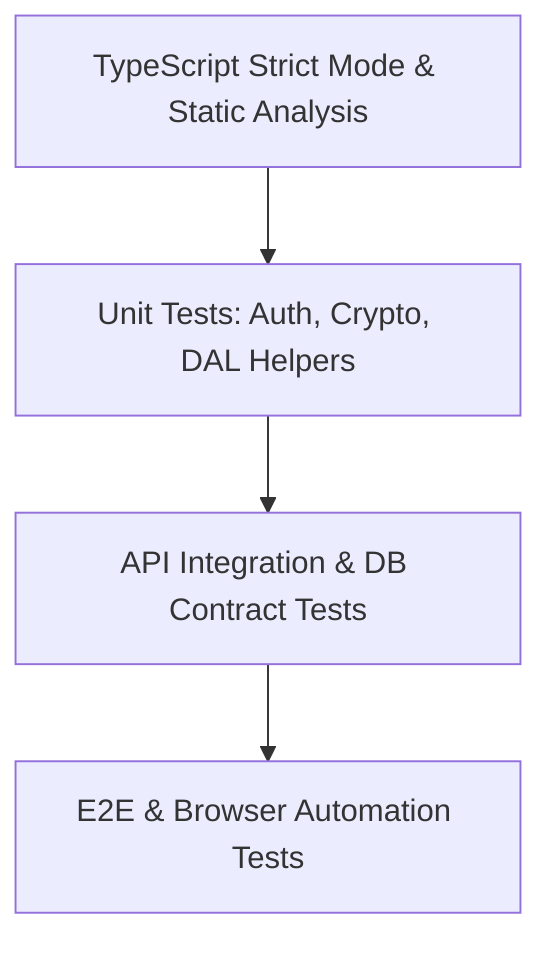

# Testing Strategy & Quality Assurance Gates

**Auditor**: Senior QA Engineer & Antigravity Gate Controller  
**Scope**: Unit Testing, Static Analysis, Build Verification, E2E Smoke Testing  

---

## 1. Quality Engineering Pyramid



---

## 2. Testing Levels & Verification Gates

### 2.1 Static Typing & Build Verification
- **Frontend Strict Mode**: Executes `tsc -b && vite build` inside `frontend/`.
  - Ensures zero implicit `any` leaks.
  - Verifies asset chunking and CSS asset bundling.
- **Backend Linting & Syntax**: Validates Node syntax across all controllers, middleware, and services via Node runtime execution.

### 2.2 Relational Integrity & Migration Tests
- **Schema Validation**: Tests schema creation via `node database/autoMigrate.js`.
- **Constraint Verification**: Tests that deleting an author cascades or restricts according to foreign key rules.

### 2.3 Authentication & RBAC Contract Checks
- **Token Tamper Tests**: Verifies that modifying a single character of a signed JWT triggers `401 Invalid Token`.
- **Privilege Escalation Gate**: Tests that students cannot access `/api/circulars/emergency` or `/api/circulars/:id/approve`.

---

## 3. Running Test Suites

```bash
# 1. Compile & verify frontend bundle
cd frontend
npm run build

# 2. Test database auto-migration & seed execution
cd ..
npm run seed

# 3. Start local development server
npm run dev
```
