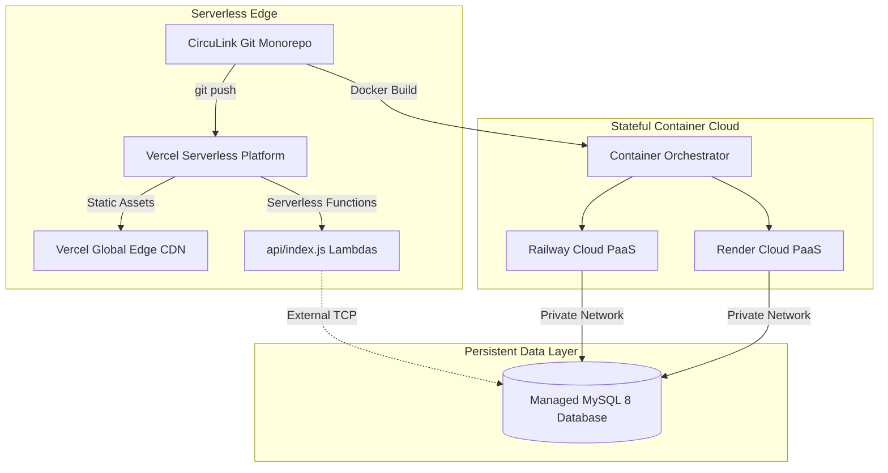

# CircuLink Deployment Audit: Cloud Infrastructure & Serverless Analysis

**Auditor**: Principal DevSecOps Engineer  
**Targets Audited**: Vercel Serverless, Docker Containerization, Railway, Render PaaS  
**Scope**: Configuration manifests, SPA serving, serverless API constraints, persistent WebSockets, storage  

---

## 1. Multi-Target Deployment Taxonomy

CircuLink is configured with support for four deployment targets:



---

## 2. Platform Audit: Vercel Serverless Deployment

### Configuration Analysis (`vercel.json`)
```json
{
  "version": 2,
  "buildCommand": "cd frontend && npm install && npm run build",
  "outputDirectory": "frontend/dist",
  "rewrites": [
    { "source": "/api/(.*)", "destination": "/api/index.js" },
    { "source": "/api", "destination": "/api/index.js" },
    { "source": "/uploads/(.*)", "destination": "/api/index.js" },
    { "source": "/(.*)", "destination": "/index.html" }
  ]
}
```

### Critical Vercel Architectural Trade-Offs & Gotchas
1. **Stateful WebSockets (Socket.IO)**:
   - *Limitation*: Vercel Serverless functions are ephemeral execution environments that terminate immediately after responding. Persistent bidirectional WebSocket handshakes (Socket.IO Engine.IO) cannot maintain active persistent connections across lambdas.
   - *Design Decision*: In Vercel serverless mode, the frontend gracefully falls back to REST polling for notifications and chat messages, while full real-time push is enabled on stateful platforms (Docker / Railway / Render).
2. **File Upload Ephemeral Storage**:
   - *Limitation*: Serverless lambdas have read-only filesystems with the exception of `/tmp` (ephemeral across invocations).
   - *Audit Finding*: `messageRoutes.js` detects `process.env.VERCEL` and redirects uploads to `/tmp`. For production permanent storage, an S3/Cloudinary bucket or persistent volume is recommended.
3. **SPA Client-Side Deep Routing**:
   - The edge rewrite `/(.*) -> /index.html` ensures that deep links like `/circulars`, `/posts`, and `/settings` are resolved by the client-side router without 404 edge errors.

---

## 3. Containerized & Stateful Cloud Deployments

### Dockerfile
- **Architecture**: Multi-stage Node 20-alpine build.
- **Stage 1 (Frontend Builder)**: Compiles Vite React 18 TypeScript bundle into `/app/frontend/dist`.
- **Stage 2 (Runtime Server)**: Installs production dependencies and serves both API routes and static SPA assets from `server.js`.
- **Port**: Exposed on port 5000 (or dynamic `process.env.PORT`).

### Railway (`railway.json`) & Render (`render.yaml`)
- Provides continuous integration, persistent disk attachment for `/uploads`, and persistent TCP sockets for full Socket.IO real-time event broadcasting and online presence heartbeats.

---

## 4. Deployment Readiness Verdict

| Deployment Target | Readiness Status | Architectural Suitability |
|---|---|---|
| **Vercel** | Production Ready (REST & SPA) | Ideal for low-cost frontend hosting + serverless API; WebSockets fall back to polling. |
| **Docker / Railway** | Production Ready (Full-Featured) | Ideal for enterprise campus deployments requiring stateful Socket.IO and local disk storage. |
| **Render** | Production Ready (Full-Featured) | Verified configuration via `render.yaml`. |
