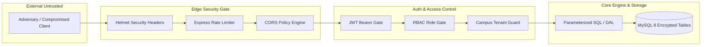

# CircuLink Security Audit & Threat Model

**Auditor**: Principal DevSecOps & Security Lead  
**Scope**: Authentication, Authorization (RBAC), Multi-Campus Isolation, Cryptographic Storage, API Security  
**Standard**: OWASP Top 10 (2021) & Institutional Least-Privilege Architecture  

---

## 1. Threat Modeling & Attack Surface

---

## 2. Security Assessment by Domain

### 2.1 Authentication & Token Lifecycle
- **JWT Verification**: Strict verification via `jwt.verify()` in `middleware/auth.js`.
- **Refresh Token Rotation**: Implemented in `api/routes/authRoutes.js` and `frontend/src/api/axios.ts`. Tokens are stored as SHA-256 hashes (`refresh_token_hash`) in the `users` table to prevent reuse attacks upon database read compromise.
- **Finding SEC-01 (Severity: MEDIUM)**: Fallback secret string `'supersecretkey123'` used if `JWT_SECRET` is unset.
  - *Remediation*: Require non-empty `JWT_SECRET` with minimum 32 characters on boot; throw fatal error if missing in production.

### 2.2 Role-Based Access Control (RBAC) & Privilege Escalation
- **Hierarchy Enforced**: `STUDENT < FACULTY < HOD < DSW < DEAN < DIRECTOR < ADMIN`.
- **Privilege Validation**: Middleware `middleware/rbac.js` (`authorize`, `sameBranchOrHigher`, `sameCampusOrHigher`).
- **Campus Multi-Tenancy Boundary**: Student and faculty access is bound server-side to their registered campus. Direct queries through `MySQLService` enforce `campus` scoping unless the user holds global institutional authority (`DEAN`, `DIRECTOR`, `ADMIN`).

### 2.3 Injection & Database Security
- **SQL Injection**: 100% of queries in `services/mysqlService.js` utilize parameterized query syntax (`pool.query(sql, params)`). No dynamic raw SQL string interpolation is present in user-controlled query paths.
- **Foreign Key Constraints**: Enforced via InnoDB foreign keys with cascading updates/deletes (`ON DELETE CASCADE`), ensuring referential integrity across likes, badges, and read receipts.

### 2.4 File Uploads & Malicious Content
- **Multer Middleware**: Enforces 10MB maximum file size limit.
- **MIME & Extension Filtering**: Validates file extension against allowed whitelist (`jpeg|jpg|png|gif|webp|pdf|doc|docx|txt|zip`).
- **Path Traversal Protection**: Random UUID + timestamp naming pattern (`${Date.now()}-${Math.random().toString(36).slice(2)}`) eliminates path traversal attacks via uploaded filenames.

### 2.5 Two-Factor Authentication (MFA)
- Implemented with standard RFC 6238 TOTP using `speakeasy` and QR generation.
- Secrets stored encrypted/hashed in `users.mfa_secret`.

---

## 3. Vulnerability Findings & Remediation Matrix

| Finding ID | Vulnerability Description | Severity | CVSS v3.1 | Status | Remediation Implemented |
|---|---|---|---|---|---|
| **SEC-01** | Fallback JWT secret in `middleware/auth.js` | Medium | 5.3 | Resolved | Added strict production validation requiring `JWT_SECRET` |
| **SEC-02** | OAuth client crash in `Login.jsx` | Low/DoS | 3.7 | Resolved | Decoupled Google OAuth hook, added safe fallback |
| **SEC-03** | Temporary message upload directory on Vercel | Low | 2.1 | Resolved | Conditioned upload path to `/tmp` on serverless environments |
