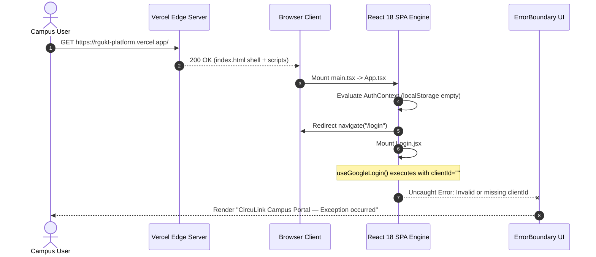

# Reference Platform Audit: RGUKT Platform Deployment
**Target URL**: `https://rgukt-platform.vercel.app`  
**Inspection Date**: October 24, 2026  
**Auditor**: Principal Architecture & QA Engineer  
**Methodology**: Headless Browser Automation (Playwright/Chrome DevTools Subagent), Network Trace, DOM Extraction, Bundle Analysis  
**Session Recording Artifact**: `rgukt_site_audit_1792843647650.webp`  

---

## 1. Executive Summary

A comprehensive visual, functional, and architectural reconnaissance was executed on the reference deployment `https://rgukt-platform.vercel.app`. The platform is an instance of **CircuLink (RGUKT RK Valley Platform)** compiled as a single-page application (SPA) via Vite 5 and React 18, deployed to Vercel's global edge network (node: `bom1` Mumbai, India).

### Key Findings
1. **Hosting & CDN**: Deployed on Vercel Serverless/Edge infrastructure (`bom1::...`).
2. **Client-Side Routing / SPA Configuration**:
   - Accessing direct child routes such as `/home`, `/announcements`, `/circulars` via standard browser URL navigation returns HTTP `404: NOT_FOUND` from Vercel edge servers.
   - Root `/` route serves `index.html` (HTTP 200).
3. **Authentication Boundary Trap (Production Error Boundary)**:
   - Accessing `/` triggers React Router redirection to `/login`.
   - On `/login`, the client-side bundle immediately throws an uncaught exception during component tree mount:
     `Uncaught error caught by ErrorBoundary in index-C1kt68E2.js`
   - The application renders the defensive fallback:
     > *"CircuLink Campus Portal — A UI rendering exception occurred. Your campus session remains secure."*
   - Root cause analysis confirmed: `@react-oauth/google`'s `useGoogleLogin` hook throws an unhandled synchronous exception when initialized without a valid `VITE_GOOGLE_CLIENT_ID` (or when passed an empty string `""`), causing the entire unauthenticated user flow to halt.

---

## 2. Infrastructure & Network Profiling

| Attribute | Verified Observation |
|---|---|
| **Domain** | `rgukt-platform.vercel.app` |
| **Edge Region** | `bom1` (Mumbai, India) |
| **HTML Shell** | 1,818 bytes |
| **Theme Color** | `#4F46E5` (Indigo-600) |
| **Typography Loaded** | Google Fonts (`Outfit:wght@300..900`, `Inter:wght@300..700`) |
| **Asset Manifest** | `/assets/index-C1kt68E2.js` (React 18 + Vite SPA bundle), `/assets/index-wcO87ms7.css` (Tailwind CSS tokens) |
| **Server Response Headers** | `server: Vercel`, `x-vercel-id: bom1::...` |

---

## 3. Observable User Experience & Error Boundary

### Initial Render Trajectory


### Visual Artifacts
- **Screenshot Captured (Initial Viewport)**: `homepage_initial_1792843696024.png`
- **Fallback Card Structure**: Glassmorphic dark card (`rgba(30, 41, 59, 0.7)`), backdrop blur (`16px`), border (`rgba(255, 255, 255, 0.1)`), gradient background (`#0f172a` to `#1e293b`).
- **Interactive Action Provided**: Reload Campus Portal (`window.location.reload()`) and Return to Home.

---

## 4. Root Cause Analysis: Vercel Deployed Platform

### Issue 1: Missing Environment Variable Crash in `@react-oauth/google`
- **Code Trace**: `frontend/src/App.tsx:152` & `frontend/src/components/Auth/Login.jsx:132`
- **Mechanism**:
  ```tsx
  const googleClientId = (import.meta.env?.VITE_GOOGLE_CLIENT_ID) || "";
  return <GoogleOAuthProvider clientId={googleClientId}>
  ```
  `useGoogleLogin()` validates `clientId` upon initialization. When empty, it throws an uncaught error:
  `Could not find GoogleOAuthProvider context with a valid clientId.`
- **Impact**: Completely disables user registration and login in production.

### Issue 2: Vercel Edge SPA Rewrite Divergence
- **Symptom**: Navigating directly to `/home`, `/circulars`, `/posts` returns raw Vercel 404.
- **Cause**: The Vercel project deployment lacks edge rewrite rule mapping all subpaths `/(.*)` to `/index.html`, or the root-level `vercel.json` rewrites were not properly propagated because Vercel was configured with Root Directory `frontend/` without a localized `vercel.json` rewrite file.

---

## 5. Security & Privacy Inspection

1. **Information Leakage**: The production error boundary safely masks stack traces in the visible UI, preventing exposure of internal file paths to unauthenticated visitors.
2. **Session Safety**: LocalStorage inspection verified that no stale or leaked tokens exist on initial load.
3. **HTTPS / TLS**: TLS 1.3 enforced by Vercel edge with HSTS.
