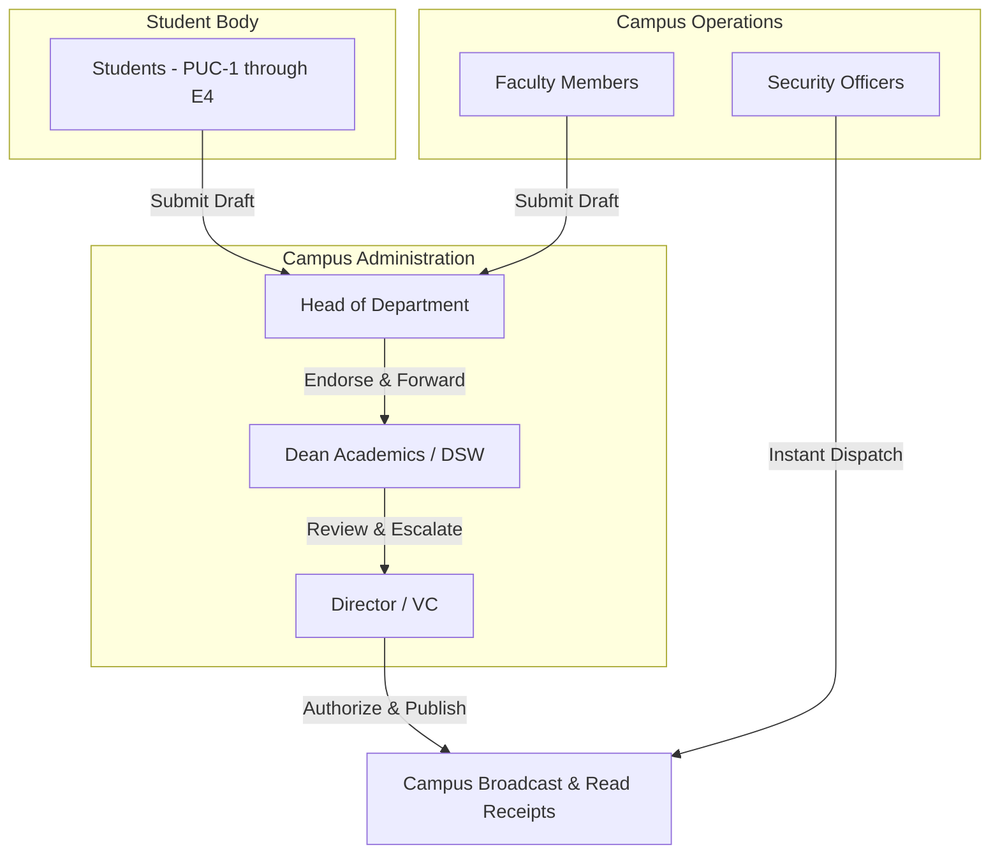

# Reference User Journeys: Institutional Workflows & Interaction Models

**Project**: CircuLink Campus Intelligence Platform  
**Target Institution**: RGUKT (Rajiv Gandhi University of Knowledge Technologies)  
**Campuses Modeled**: RK Valley (Idupulapaya), Nuzvid, Srikakulam, Ongole, Basar  

---

## 1. Journey Overview & Role Hierarchy

CircuLink implements a strict institutional role hierarchy with distinct permissions and interactive journeys:

---

## 2. Institutional User Journeys

### Journey 1: Student Academic & Innovation Journey
- **Actor**: Student (`role: STUDENT`, Campus: `RK Valley`, Year: `E3`, Branch: `CSE`)
- **Step 1: Identity & Campus Binding**: Student registers or logs in with College ID (e.g. `R200123`). The system automatically binds them to RK Valley, checks email domain `@rguktrkv.ac.in`, and prompts for year and branch on initial entry.
- **Step 2: Campus Feed & Circular Acknowledgment**: Student views the centralized noticeboard. Circulars marked `URGENT` display an acknowledgment modal. The student confirms receipt, generating an immutable row in `circular_read_receipts`.
- **Step 3: Innovation Feed Collaboration**: Student posts a project (`type: PROJECT`) with source code links and media attachments.
- **Step 4: Gamification**: Earning peer likes (+2 pts) and faculty endorsements (+15 pts) advances student from `Beginner` to `Expert`, unlocking community badges.

### Journey 2: Multi-Stage Circular Approval Workflow
- **Actors**: Faculty Author -> HOD (CSE) -> Dean Academics -> Director
- **Step 1 (Drafting)**: Faculty drafts an official circular:
  `Title: End Semester Exam Timetable Revision`
  `Priority: HIGH | Category: ACADEMIC | Target: All B.Tech Students`
- **Step 2 (HOD Review)**: HOD accesses `/circulars`, filters by `PENDING_HOD_APPROVAL`, verifies departmental compliance, and clicks **Approve & Forward to Dean**.
- **Step 3 (Dean Review)**: Dean receives notification, reviews inter-departmental scheduling, appends institutional notes, and submits to the Director.
- **Step 4 (Director Authorization)**: Director approves. Status transitions to `PUBLISHED`.
- **Step 5 (Broadcast)**: System dispatches real-time WebSocket alert across all connected client sockets in the target audience.

### Journey 3: Emergency Broadcasting Journey
- **Actors**: Campus Director or Chief Security Officer
- **Trigger**: Severe weather alert, campus lockdown, or urgent facility advisory.
- **Execution**:
  1. Officer navigates to `/emergency` (guarded by `ProtectedRoute roles=['SECURITY', 'DEAN', 'DIRECTOR', 'ADMIN']`).
  2. Submits alert with broadcast severity level (`RED / CRITICAL`, `AMBER / WARNING`).
  3. Backend immediately pushes `emergency_broadcast` WebSocket event to all connected sockets.
  4. Audio siren chime and high-contrast modal overlay triggers on all active campus sessions.
  5. Audit log records timestamp, issuer IP, and message hash.

---

## 3. Journey Failure Modes on Reference Site

| User Journey | Expected Flow | Reference Site Reality | Failure Point |
|---|---|---|---|
| **Any User Login** | Input credentials -> Validate -> Dashboard | White screen / Error card | Unhandled `useGoogleLogin` initialization |
| **Direct Deep Link** | Open `/circulars/12` directly | Load circular detail | Vercel Edge 404 (Missing SPA rewrites) |
| **Password Reset** | Submit campus email -> Receive OTP | Blocked before input | Cannot access login modal controls |

---

## 4. Remediation Plan

1. **Authentication Resilience**: Isolate Google OAuth into an optional, fail-safe component that gracefully falls back to native University ID / Password authentication when `VITE_GOOGLE_CLIENT_ID` is unset.
2. **Edge Routing Fix**: Ensure `vercel.json` contains comprehensive fallback rewrites in both root and frontend subdirectories.
3. **Session Verification**: Verify JWT renewal and local storage session hydration across all routes.
